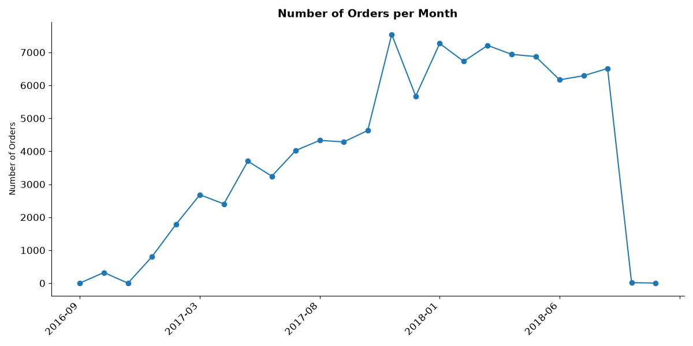
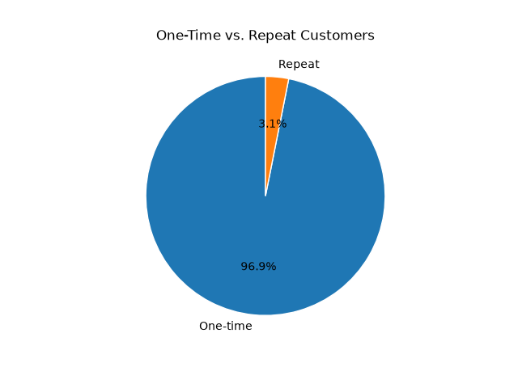
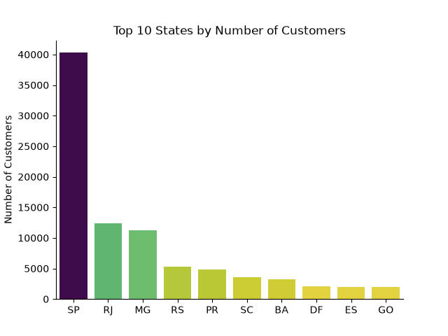
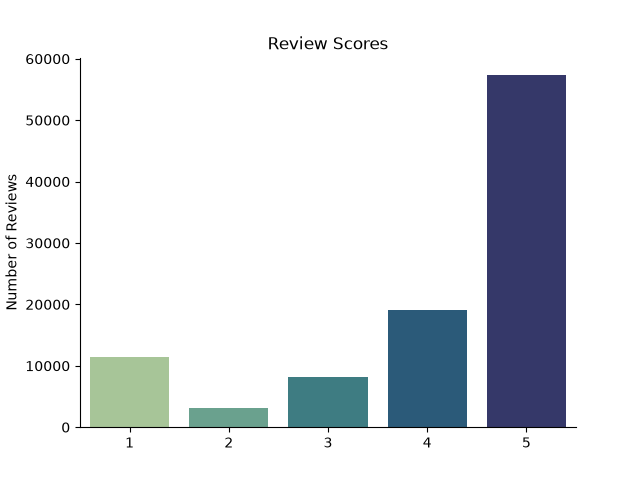
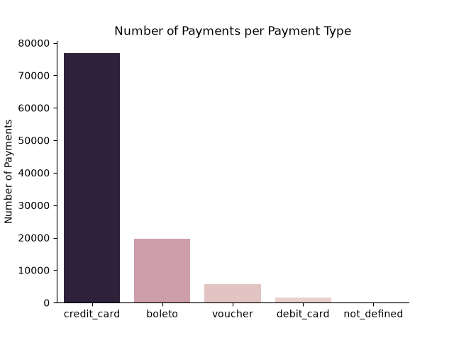
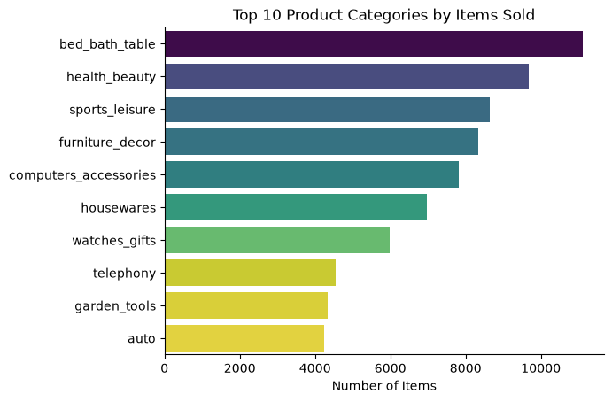
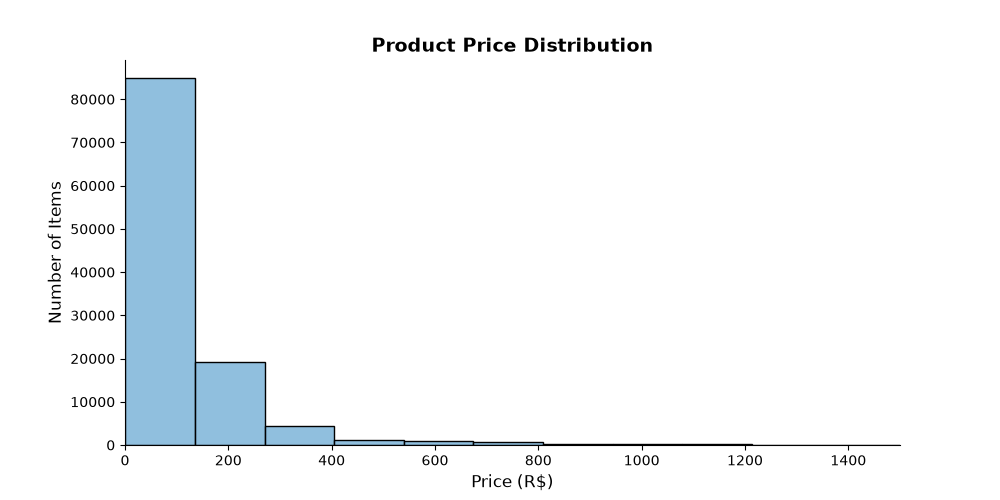

# 🛒 Brazilian E-Commerce Sales Analysis

## Introduction

This project analyzes the Olist Brazilian E-Commerce dataset in two parts. First, **SQL** (PostgreSQL) explores revenue, customer behavior, delivery performance and customer satisfaction. Then **Python** (pandas, matplotlib, seaborn) answers questions the SQL part could not: how delivery delays affect reviews, how revenue grew over time, which categories sell a lot but disappoint customers, and how late deliveries combine region and season.
 
The data comes from the [Brazilian E-Commerce Public Dataset by Olist](https://www.kaggle.com/datasets/olistbr/brazilian-ecommerce) on Kaggle and includes orders, customers, products, sellers, payments and reviews from 2016-2018.
 
- SQL queries: [`project_sql/`](./project_sql/)
- Python notebooks: [`project_python/`](./project_python/)

## Questions I wanted to answer
 
**SQL**
1. Which product categories generate the most revenue?
2. How many customers are repeat buyers vs. one-time buyers?
3. What is the average order value by customer state?
4. Which states have the most customers?
5. How does average delivery time vary by state?
6. What percentage of orders are delivered late, and does it vary by state?
7. Which month has the highest rate of late deliveries?
8. How does customer satisfaction (review score) vary by product category?


**Python**

## Tools I used
 
- **SQL & PostgreSQL**: querying, joins, CTEs, aggregation
- **Python** (pandas): data cleaning, merging, aggregation
- **Matplotlib & Seaborn**: visualizations
- **VS Code & Git/GitHub**: development and version control

## Dataset and setup
 
Download the CSV files from Kaggle and place them in `csv_files/` (ignored by Git). The notebooks read them from `../csv_files/`. Create the environment with:
 
```bash
conda create -n olist python=3.11 pandas matplotlib seaborn jupyter ipykernel adjusttext
conda activate olist
```
 
Currency is the Brazilian real (R$). "Revenue" means item price only, excluding freight.
 
## The Analysis (SQL)

<details>
<summary><b>Click to expand SQL Analysis</b></summary>

### 1. Top Revenue Categories
To identify which product categories generate the most sales, I joined order items with the products and category translation tables, summing revenue (price) and freight separately for each category.

> **Key finding:** Health & Beauty was the top-earning category with R$1,258,681 in revenue, followed closely by Watches & Gifts (R$1,205,006) and Bed, Bath & Table (R$1,036,989). Interestingly, the top 3 categories span very different product types — personal care, luxury/gift items, and home goods — suggesting Olist's revenue isn't concentrated in a single niche, but spread across several strong, unrelated categories.

*Note: "Revenue" in this analysis refers to product price only (excluding freight/shipping charges), consistent with treating shipping as a pass-through cost rather than earned revenue.*

### 2. Repeat vs. One-Time Customers

To measure customer retention, I counted the number of orders per unique customer (using `customer_unique_id`, since `customer_id` is generated per-order rather than per-person in this dataset), then classified each customer as "one-time" or "repeat" based on that count.

> **Key finding:** Only 2,997 customers (about 3%) made more than one purchase, while 93,099 (97%) were one-time buyers. This is a striking retention problem — Olist's revenue relies almost entirely on constantly acquiring new customers rather than repeat business, which is typically far more expensive and less sustainable than retaining existing ones.

### 3. Average Order Value by State

To measure spending patterns by region, I first summed order item prices per order (to get each order's total value), then averaged those order totals grouped by customer state.

> **Key finding:** Average order value varies notably by state, ranging from R$216.67 in Paraíba (PB) down to around R$143 in Rio de Janeiro (RJ) — despite RJ being one of Brazil's largest, most economically developed states. This suggests that order value isn't simply driven by regional wealth or market size; smaller or less-saturated markets may see fewer but higher-value purchases.

### 4. Top States by Number of Customers
To see where Olist's customer base is concentrated, I counted distinct customers per state directly from the customers table.

> **Key finding:** São Paulo (SP) dominates with 40,302 customers — over 3x more than the second-place state, Rio de Janeiro (12,384). The top 2 states alone (SP and RJ) account for a substantial share of the customer base, while the remaining top 10 states each contribute a few thousand customers, showing a heavily concentrated, São Paulo-centric market rather than an evenly distributed national presence.

### 5. Average Delivery Time by State
To measure delivery speed by region, I calculated the number of days between purchase and actual delivery for each order, then averaged by customer state.

> **Key finding:** Delivery time varies significantly by state, from around 19 days in states like PI up to 29.3 days in RR (Roraima) — over a week and a half slower. States with the longest delivery times are generally in Brazil's more remote North region, likely reflecting greater logistical distance from Olist's main distribution hubs in the Southeast.

### 6. Percentage of Late Deliveries by State

Extending the delivery time analysis, I used a CASE statement to flag each order as "late" (delivered after the estimated delivery date) or "on time", then calculated the percentage of late orders per state.

> **Key finding:** Late delivery rates vary widely, from around 21.4% in Alagoas (AL) down to under 10% in states like MS and TO. Notably, this ranking doesn't fully match the "average delivery days" results from the previous query — RR had the longest average delivery time overall, but only a 12.2% late rate, suggesting Olist may already be setting longer estimated delivery windows for that state to account for the distance, rather than consistently underestimating it.

### 7. Late Delivery Rate by Month
Extending the late-delivery analysis from Query 6, I flagged each order as "late" or "on time" and grouped by the month the order was purchased, instead of by state.

> **Key finding:** March had the highest late-delivery rate at 15.1%, followed by November at 12.4% — notably, November includes Black Friday, suggesting a spike in order volume during peak shopping season may strain Olist's delivery capacity. In contrast, June had the lowest late rate at just 1.8%, nearly 8x better than March.

### 8. Customer Satisfaction by Product Category
To see how customer satisfaction varies by product type, I joined reviews with order items and products, calculating the average review score per category (using the English category names for readability).

> **Key finding:** CDs/DVDs/Musicals had the highest average rating (4.64), followed by Fashion Children's Clothes (4.50) and Books - General Interest (4.45) — suggesting media and books tend to meet expectations reliably, likely because they're low-risk, standardized purchases. At the other end, Security & Services scored lowest by far (2.50, though with only 2 reviews), while Diapers & Hygiene (3.26) and Portable Kitchen & Food Preparers (3.27) were the lowest categories with meaningful review volume — both product types where quality/functionality issues would directly and noticeably affect the buyer's experience.

*Note: A small number of reviews (1,598) belong to products with no assigned category (NULL), likely a data quality gap in the original product listings.*

</details>

## The Analysis (Python)
 
<details>
<summary><b>Click to expand Python Analysis</b></summary>

### 1. Exploratory Data Analysis

Before answering specific questions, I explored the Olist dataset to understand its size, quality and shape: order volume over time, review scores, payment methods, repeat customers, the biggest states, the best-selling categories and the price distribution.

See notebook: [`1_EDA_intro.ipynb`](./project_python/1_EDA_intro.ipynb)

#### Orders over time



> **Key insight:** Olist grew quickly through 2017, from about 800 orders in January to about 4,600 in October. Orders peaked in **November 2017 at about 7,500**, most likely because of Black Friday, then dropped to about 5,700 in December and settled at roughly 6,200 to 7,300 per month during 2018. The first months of 2016 and the last two months of 2018 have almost no orders, because the data collection started and ended mid-period, so those months should be left out of any trend analysis. The November peak matches the SQL finding that late deliveries rise in November.

#### Customers



> **Key insight:** Only **3.1%** of customers ordered more than once, while **96.9%** bought a single time. This confirms the SQL result (2,997 repeat vs. 93,099 one-time customers) and shows that Olist depends almost entirely on acquiring new customers.



> **Key insight:** The customer base is heavily concentrated: **São Paulo (SP)** has more than three times as many customers as Rio de Janeiro (RJ), and SP, RJ and Minas Gerais (MG) together account for about two thirds of all customers. The remaining states in the top 10 (RS, PR, SC, BA, DF, ES, GO) each have only a few thousand.

#### Reviews and payments



> **Key insight:** Customers are mostly satisfied: about **58%** of reviews are 5 stars and about 77% are 4 or 5 stars. The distribution is not smooth, though. 1-star reviews (about 11%) are more common than 2-star or 3-star reviews, which means that unhappy customers tend to be very unhappy. This is what the later notebook on late deliveries investigates.



> **Key insight:** **Credit card** is by far the most used payment method (roughly three quarters of payments), followed by **boleto**, a Brazilian bank-slip payment (about 19%). Vouchers and debit cards together make up only a small share, and `not_defined` is practically empty.

#### Products



> **Key insight:** `bed_bath_table` sells the most items (about 11,100), followed by `health_beauty` (about 9,700) and `sports_leisure` (about 8,600). The ranking by items differs from the SQL ranking by revenue: `watches_gifts` is only 7th by items sold (about 6,000) but 2nd by revenue, and `bed_bath_table` is first by items but only 3rd by revenue. This suggests that watches and gifts have a much higher price per item, while bed and bath products sell in volume at lower prices.



> **Key insight:** Prices are strongly right-skewed. Roughly three quarters of the items cost less than about R$135, and a long tail of expensive items reaches R$1,400 and above. Because of this tail, the median describes a typical price better than the mean.

</details>


## What I Learned
Working through this project deepened my SQL skills in several ways beyond the fundamentals from my first project:

- **Two-step aggregation:** Recognizing when raw data is "too granular" for the question being asked — such as averaging order value, where I first had to sum item-level prices into order-level totals (via a CTE) before averaging across orders, to avoid distorting results.
- **CASE for classification, not just display:** Using `CASE` to flag individual rows (e.g. "late" vs. "on time") *before* aggregating, rather than applying it to an already-averaged result — an important distinction that changes what the analysis actually measures.
- **The `SUM(CASE...)` counting pattern:** Using `SUM()` on 0/1 flags as a way to count how many rows meet a condition within each group, alongside `COUNT(*)` for the total, to calculate percentages.
- **Working with real-world data quality issues:** Encountering and resolving foreign key violations caused by missing category translations, and NULL categories in the review data — realistic problems that don't show up in cleaner tutorial datasets.
- **Choosing the right grain for `customer_id`:** Learning to distinguish between `customer_id` (unique per order) and `customer_unique_id` (unique per person) — a dataset-specific quirk that would have silently produced wrong retention numbers if missed.
